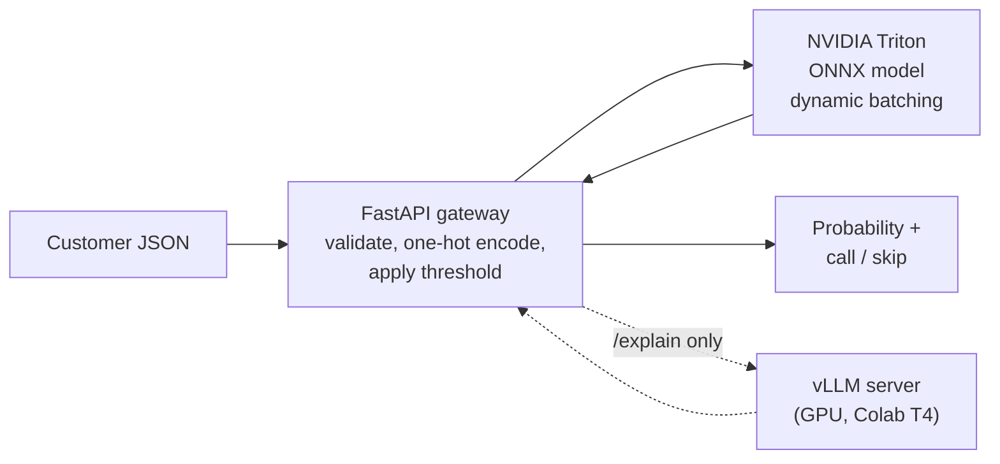

# Term-Deposit Lead Scoring

A bank phones customers about a term deposit, and only about 12% say yes. This project takes a customer's profile, predicts how likely they are to say yes, and serves that prediction the way a production system would: a model server, an API in front of it, load testing, and an LLM that writes a short plain-English note for each score.

**What I built**

- Trained a scikit-learn model and exported it to **ONNX**.
- Served it with **NVIDIA Triton Inference Server** in Docker, with dynamic batching.
- Put a **FastAPI** gateway in front that accepts a customer as normal JSON and returns a probability and a "call" or "skip" decision.
- Wrote an async **benchmark** and measured what dynamic batching does to latency and throughput.
- Added an `/explain` endpoint that asks an LLM served by **vLLM** for a short note on each score.

> **Status:** model, Triton serving, gateway and benchmark are done and measured. The `/explain` endpoint is implemented and unit-tested against a mocked LLM, and the vLLM server has been run on a Colab T4 GPU; a full end-to-end run of gateway to vLLM is still to be recorded.

## How it works



- **Gateway** (`gateway/app.py`): checks the input, turns words like `job: management` into the 50 numbers the model was trained on, calls Triton, and applies the tuned decision threshold. It rejects the `duration` field on purpose (see below).
- **Triton** (`model_repository/`): runs `model.onnx`. `lead_scorer` has dynamic batching on; `lead_scorer_nobatch` is the same model with it off, for comparison.
- **vLLM** (optional): serves a small open model that writes two sentences about a score. Scoring never depends on it: if the LLM is down, `/explain` still returns the score.

## Quick start

Requires Docker (GitHub Codespaces works well).

**1. Start Triton** (from the repo root):

```bash
docker run --rm -p 8000:8000 -p 8001:8001 -p 8002:8002 \
  -v $PWD/model_repository:/models \
  nvcr.io/nvidia/tritonserver:24.08-py3 \
  tritonserver --model-repository=/models
```

Wait for `lead_scorer` and `lead_scorer_nobatch` to show `READY`. Health check (expect `200`):

```bash
curl -s -o /dev/null -w "%{http_code}\n" localhost:8000/v2/health/ready
```

**2. Start the gateway** (second terminal):

```bash
cd gateway
python3 -m pip install -r requirements.txt
uvicorn app:app --port 8080
```

**3. Score a customer** (third terminal, from the repo root):

```bash
curl -s -X POST localhost:8080/score -H "Content-Type: application/json" -d @gateway/sample_customer.json
```

Example response:

```json
{"probability": 0.4551, "threshold": 0.178, "decision": "call", "triton_ms": 27.26}
```

### Optional: LLM explanations

`/explain` needs a vLLM server reachable over HTTP. I ran one on a free Colab T4 GPU and exposed it with a temporary tunnel. Point the gateway at it before starting:

```bash
export VLLM_URL="https://<your-tunnel>.trycloudflare.com"
export VLLM_API_KEY="<the key printed by the server notebook>"
uvicorn app:app --port 8080
```

Without `VLLM_URL`, `/explain` returns the score with `explanation: null`.

## API

| Endpoint | What it does |
|---|---|
| `GET /health` | `200` if the gateway can reach a ready Triton, else `503` |
| `POST /score` | One customer in, probability and `call`/`skip` out |
| `POST /score/batch` | 1 to 1,000 customers; split into chunks of 64 for Triton |
| `POST /explain` | Like `/score`, plus a short LLM-written note (needs vLLM) |

Unknown category values return `422` with the list of allowed values. Triton unreachable returns `503`; a Triton error returns `502`.

## Problem and data

- **Dataset:** [UCI Bank Marketing](https://archive.ics.uci.edu/dataset/222/bank+marketing) (id 222), `bank-full.csv`, 45,211 rows x 17 columns, semicolon-separated. The data is not stored in this repo.
- **Leakage note:** the `duration` column (call length) is dropped because it is only known after the call. The gateway rejects it for the same reason.

To reproduce training:

1. Download the zip from the UCI page above and unzip it, then unzip the inner `bank.zip` to get `bank-full.csv`.
2. Put `bank-full.csv` in a `data/` folder (git-ignored), or in Google Drive if you use Colab.
3. Update `path` in the notebook's loading cell.

Citation: Moro, S., Cortez, P., Rita, P. (2014). A data-driven approach to predict the success of bank telemarketing. Decision Support Systems.

## Model results (held-out test split, 9,043 rows)

| Model | ROC AUC |
|---|---|
| Logistic Regression (baseline) | 0.772 |
| Random Forest | 0.792 |
| HistGradientBoosting | 0.803 |
| **GradientBoosting (chosen)** | **0.802** |

Decision threshold tuned for F1: **0.178** (precision 0.47, recall 0.53, F1 0.50), compared with recall 0.20 at the default 0.5. The ONNX export matches scikit-learn to within 3.9e-07.

## Benchmark results

All numbers come from `benchmark/bench.py`: 2,000 requests per concurrency level after a 100-request warm-up, with random but valid customers, over HTTP with JSON. Everything ran on a single 2-core GitHub Codespace, with Triton, the gateway and the load generator all sharing the same CPU. **Treat the numbers as relative comparisons, not absolute performance.** Each figure is from a single run.

### Triton directly: dynamic batching on vs. off

| Model | Concurrency | Req/s | p50 ms | p95 ms | p99 ms |
|---|---|---|---|---|---|
| batching on | 1 | 127.8 | 7.06 | 11.70 | 17.19 |
| batching off | 1 | 355.2 | 2.50 | 4.93 | 8.80 |
| batching on | 8 | 451.0 | 15.33 | 33.18 | 54.60 |
| batching off | 8 | 322.5 | 15.09 | 69.51 | 117.70 |
| batching on | 32 | 219.2 | 86.65 | 459.01 | 696.66 |
| batching off | 32 | 212.1 | 98.22 | 452.75 | 687.12 |
| batching on | 64 | 187.0 | 227.58 | 991.28 | 1577.81 |
| batching off | 64 | 197.9 | 223.99 | 924.41 | 1391.66 |

What this shows:

- **Low load (1 request at a time):** dynamic batching adds about 4.5 ms of latency. This is consistent with the 5 ms `max_queue_delay_microseconds` setting, because Triton waits briefly for other requests that never arrive.
- **Moderate load (8 concurrent):** batching gives about 40% more throughput and a much better tail (p99 55 ms vs. 118 ms).
- **High load (32 and 64):** both configurations are saturated and perform about the same. On this 2-core machine the CPU is the limit, so the differences here are within what I would expect from run-to-run noise.

### Through the FastAPI gateway (`/score`, batching on)

| Concurrency | Req/s | p50 ms | p95 ms | p99 ms |
|---|---|---|---|---|
| 1 | 69.7 | 13.21 | 23.49 | 31.34 |
| 8 | 114.5 | 61.68 | 132.58 | 186.49 |
| 32 | 76.7 | 281.52 | 1245.41 | 1932.99 |
| 64 | 55.7 | 760.72 | 3409.72 | 5069.83 |

The gateway adds validation, feature encoding and an extra HTTP hop, so it is slower than calling Triton directly, and it degrades faster under load. Part of the cost is Python and JSON overhead, and part is the three processes sharing two cores. I have not profiled to separate the two.

### Reproduce

```bash
python3 benchmark/bench.py --target triton --models lead_scorer lead_scorer_nobatch --json benchmark/results_triton.json
python3 benchmark/bench.py --target gateway --json benchmark/results_gateway.json
```

Raw results are in `benchmark/results_*.json`.

## Limitations

- The threshold and model comparison used the test split, so the reported numbers are slightly optimistic; a single train/test split was used.
- Benchmarks ran on a shared 2-core CPU machine, once per setting. Use them to compare configurations, not as production capacity figures.
- The LLM sees only the customer's details and the final score. It does **not** know what drove the model's prediction, so its note describes the profile and the recommendation, not the model's real reasons. Real reasons would need a feature-attribution method such as SHAP.
- The vLLM server ran on a free Colab T4 behind a temporary tunnel, so it is a demo setup, not a deployment.

## Repo layout

```
notebooks/01_train_and_export_model.ipynb   training, threshold tuning, ONNX export
model_repository/                           Triton models (lead_scorer, lead_scorer_nobatch) + metadata.json
gateway/                                    FastAPI gateway (/health, /score, /score/batch, /explain)
benchmark/                                  async load test + raw results
.devcontainer/                              Codespaces setup with Docker
```

## Next steps

1. Record a full end-to-end `/explain` run against the Colab vLLM server and add the server notebook to `notebooks/`.
2. Add feature-attribution (SHAP) so explanations reflect the model's actual drivers.
3. Optional: run the stack on Kubernetes with `kind`.